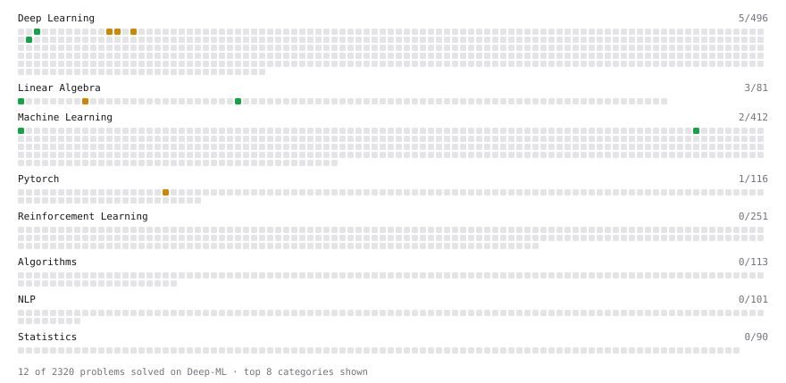

# Deep-ML

My machine learning practice from [Deep-ML](https://www.deep-ml.com). Every solution here was written by hand.

**11** solved · 8 problems · 0 labs · 3 math

[**Browse the interactive portfolio**](https://debarshi29.github.io/deep-ml/) to replay this filling in over time.

## Problems

| | Difficulty | Solved | |
| --- | --- | --- | --- |
| [Calculate Number of Parameters in Neural Network](https://www.deep-ml.com/problems/371) | easy | 2026-11-16 | [solution](problems/0371-calculate-number-of-parameters-in-neural-network) |
| [Linear Regression Using Normal Equation](https://www.deep-ml.com/problems/14) | easy | 2026-02-03 | [solution](problems/0014-linear-regression-using-normal-equation) |
| [Matrix-Vector Dot Product](https://www.deep-ml.com/problems/1) | easy | 2026-10-28 | [solution](problems/0001-matrix-vector-dot-product) |
| [Single Neuron](https://www.deep-ml.com/problems/24) | easy | 2026-11-16 | [solution](problems/0024-single-neuron) |
| [Implement an LSTM Cell from Scratch](https://www.deep-ml.com/problems/907) | medium | 2026-11-09 | [solution](problems/0907-implement-an-lstm-cell-from-scratch) |
| [Implement Long Short-Term Memory (LSTM) Network](https://www.deep-ml.com/problems/59) | medium | 2026-11-09 | [solution](problems/0059-implement-long-short-term-memory-lstm-network) |
| [Implement Self-Attention Mechanism](https://www.deep-ml.com/problems/53) | medium | 2026-03-21 | [solution](problems/0053-implement-self-attention-mechanism) |
| [Implementing a Simple RNN](https://www.deep-ml.com/problems/54) | medium | 2026-10-28 | [solution](problems/0054-implementing-a-simple-rnn) |

## Math

| | Difficulty | Solved | |
| --- | --- | --- | --- |
| [Derivatives and Gradients](https://www.deep-ml.com/math-problems/1) | easy | 2026-11-17 | [solution](math/0001-derivatives-and-gradients) |
| [Matrix Multiplication](https://www.deep-ml.com/math-problems/10) | medium | 2026-11-17 | [solution](math/0010-matrix-multiplication) |
| [Multivariate Calculus](https://www.deep-ml.com/math-problems/2) | medium | 2026-11-17 | [solution](math/0002-multivariate-calculus) |

---

_This file is regenerated by Deep-ML on every push._
